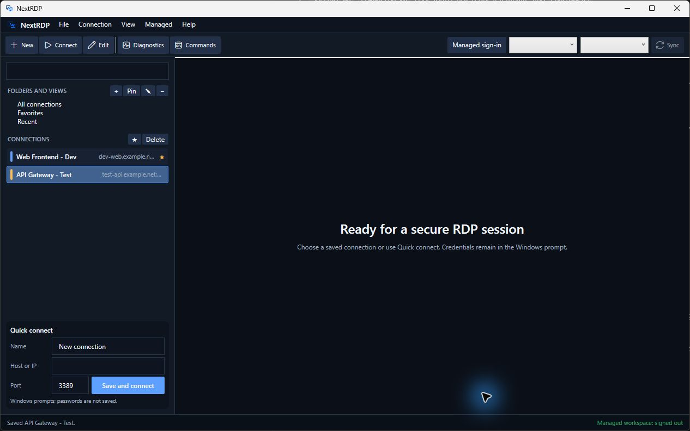

# NextRDP

[](https://github.com/mikerte/nextrdp/actions/workflows/ci-windows.yml)
[](https://github.com/mikerte/nextrdp/actions/workflows/compose-smoke.yml)
[](LICENSE)
[](https://dotnet.microsoft.com/)

NextRDP is a native Windows remote-desktop manager with a secure local inventory and an optional self-hosted shared-management platform. It embeds the Microsoft RDP client in a tabbed WPF interface and keeps RDP passwords in the Windows credential prompt.



## Project status

| Component | Status | Intended use |
| --- | --- | --- |
| Windows desktop | Working early-access MVP | Local connection inventory and direct RDP sessions on Windows 11 x64 |
| Self-hosted management | Functional preview | Evaluation of shared inventory, policy, synchronization, administration, and automation |
| Production release | Not available | The source-only `0.2.0-preview.1` checkpoint has no production-signed binaries; external identity/infrastructure validation and release readiness remain outstanding |

The [`0.2.0-preview.1` GitHub pre-release](https://github.com/mikerte/nextrdp/releases/tag/v0.2.0-preview.1) is source-only. There are no official production binaries. Test-signed packages created from source are for local evaluation only.

## What works

### Windows desktop

- Create and edit profiles with nested folders, tags, favorites, recents, environment markers, notes, username hints, and fuzzy search.
- Open Microsoft RDP sessions in tabs with NLA, automatic reconnect, smart sizing, full screen, multiple display modes, clipboard, drive, printer, audio, and extended device-redirection controls.
- Import `.rdp` and RDCMan `.rdg` files through a preview, validation, and deduplication flow that discards password and credential fields.
- Run DNS, TCP-port, gateway, and local RDP-control diagnostics with actionable redacted errors.
- Export secret-free inventory data and create aggressively redacted support packages.
- Use dark/light themes, keyboard-first navigation, accessible labels, production warnings, environment borders, and optional production watermarks.

### Self-hosted management preview

- Manage organizations, workspaces, shared/personal connections, folders, metadata, dynamic groups, templates, layouts, and saved workspaces.
- Publish inherited organization → workspace → folder → connection policy with locks, provenance, history, comparison, and rollback.
- Synchronize permitted managed inventory to the Windows client with a read-only offline cache and revocation handling.
- Use the administration console, versioned REST/OpenAPI, CLI, and PowerShell automation.
- Run PostgreSQL, OpenFGA, OPA, the ASP.NET Core control plane, and the React administration console with Docker Compose.
- Create authenticated encrypted backups and validate an isolated restore.

The [Phase 2 validation matrix](docs/validation/phase2-completion.md) distinguishes local implementation evidence from checks that still require real identity, domain, gateway, RemoteApp, monitor, or redirected-device infrastructure.

## Security boundary

- NextRDP never stores RDP passwords. Windows prompts for credentials when a session opens.
- Password blobs, tokens, private keys, and credential-shaped fields are removed from imports before preview or persistence.
- Connection profiles, exports, synchronization contracts, audit data, and support packages are designed to remain secret-free or redacted.
- The local Development identity is available only in the Development deployment and must not be exposed as a production authentication method.
- Production-shaped control-plane startup requires certificate-protected ASP.NET Core Data Protection keys.

Read [SECURITY.md](SECURITY.md) and the [threat model](docs/threat-model.md) before exposing the self-hosted platform or evaluating it with sensitive environments.

## Quick start: Windows desktop

### Prerequisites

- Windows 11 x64.
- [.NET 10 SDK](https://dotnet.microsoft.com/download/dotnet/10.0) compatible with `global.json`.
- Visual Studio Community 2026 with **.NET desktop development**, a Windows SDK, and the .NET Framework SDK tools that provide `AxImp.exe`.
- Windows Remote Desktop client components.

Clone, build, and run:

```powershell
git clone https://github.com/mikerte/nextrdp.git
Set-Location .\nextrdp
.\scripts\build.ps1 -Configuration Release
dotnet run --project .\src\NextRdp.Desktop\NextRdp.Desktop.csproj -c Release
```

If `AxImp.exe` is installed in a non-standard location, pass it explicitly:

```powershell
dotnet build .\NextRdp.slnx -c Release -p:AxImpPath="D:\Tools\AxImp.exe"
```

Application data is stored at `%LOCALAPPDATA%\NextRDP\nextrdp.db`. Do not place credentials in profiles, command lines, samples, screenshots, logs, or repository files.

See [desktop installation](docs/install-desktop.md) for self-contained builds, test-MSIX installation, upgrades, uninstall, and troubleshooting.

## Quick start: self-hosted preview

Install Docker Desktop, copy the example environment file, and replace the placeholder with a long disposable local password:

```powershell
Copy-Item .env.example .env
# Edit POSTGRES_PASSWORD in .env, then:
docker compose up -d --build --wait
```

Open `http://127.0.0.1:5090`. The default Compose file binds the administration console and control-plane API to localhost and enables the development identity only for local evaluation.

Stop the stack without deleting its volumes:

```powershell
docker compose down
```

See [self-hosting](docs/self-hosting.md) for health checks, backup/restore, production-shaped certificate settings, data cleanup, and limitations.

## Build and validation

```powershell
.\scripts\build.ps1 -Configuration Release
.\scripts\test.ps1 -Configuration Release
.\scripts\check-phase1.ps1 -Configuration Release
.\scripts\check-phase2.ps1 -Configuration Release
```

The checks build with warnings treated as errors, validate the complete feature catalog, run the .NET and administration-console suites, audit dependencies, scan first-party text for credentials, exercise real RDP ActiveX activation on Windows, and validate the Compose configuration.

For the live self-hosted integration and restore drill, use disposable local values that are never committed:

```powershell
.\scripts\check-phase2.ps1 -Configuration Release -Live `
  -PostgresPassword '<local-only value>' `
  -BackupPassphrase '<local-only value>'
```

The [development guide](docs/development.md) explains the solution layout, generated RDP interop assemblies, frontend workflow, tests, and contribution checks.

## Build evaluation packages

```powershell
.\scripts\build-preview-release.ps1
```

The command runs the full Phase 1/2 release gate and writes a self-contained x64 ZIP, locally test-signed `NextRDP.Client` MSIX, release manifest, and SHA-256 hashes under `artifacts\release\v0.2.0-preview.1\`. It does not install the package or modify machine trust.

Development builds created before the public-source launch used identity `NextRDP.Hackathon`. Uninstall that old test package before installing `NextRDP.Client`; Windows treats them as separate applications.

On an elevated clean Windows 11 x64 test account, the isolated acceptance runner temporarily trusts only the generated development certificate, installs and launches the package, uninstalls it, and removes the trust entry it added:

```powershell
.\scripts\test-msix-install.ps1
```

This is not a production distribution path. A public binary release requires a protected Authenticode certificate and a separate release review.

## Documentation

- [Desktop installation](docs/install-desktop.md)
- [Development](docs/development.md)
- [Self-hosting](docs/self-hosting.md)
- [Architecture](docs/architecture.md)
- [Phase 2 architecture](docs/architecture/phase2.md)
- [Threat model](docs/threat-model.md)
- [Roadmap](docs/roadmap.md)
- [Preview release notes](docs/releases/v0.2.0-preview.1.md)
- [Feature catalog](docs/reference/feature-catalog.csv)
- [Validation evidence](docs/validation/)

## Contributing and support

Read [CONTRIBUTING.md](CONTRIBUTING.md) before opening a pull request. Use [GitHub Discussions](https://github.com/mikerte/nextrdp/discussions) for setup questions and [GitHub Issues](https://github.com/mikerte/nextrdp/issues) for reproducible bugs or scoped feature requests. Report vulnerabilities privately as described in [SECURITY.md](SECURITY.md).

NextRDP is licensed under the [Apache License 2.0](LICENSE). The NextRDP name and logo are covered by the separate [trademark notice](TRADEMARKS.md). Third-party components retain their own licences; see [THIRD-PARTY-NOTICES.md](THIRD-PARTY-NOTICES.md).
